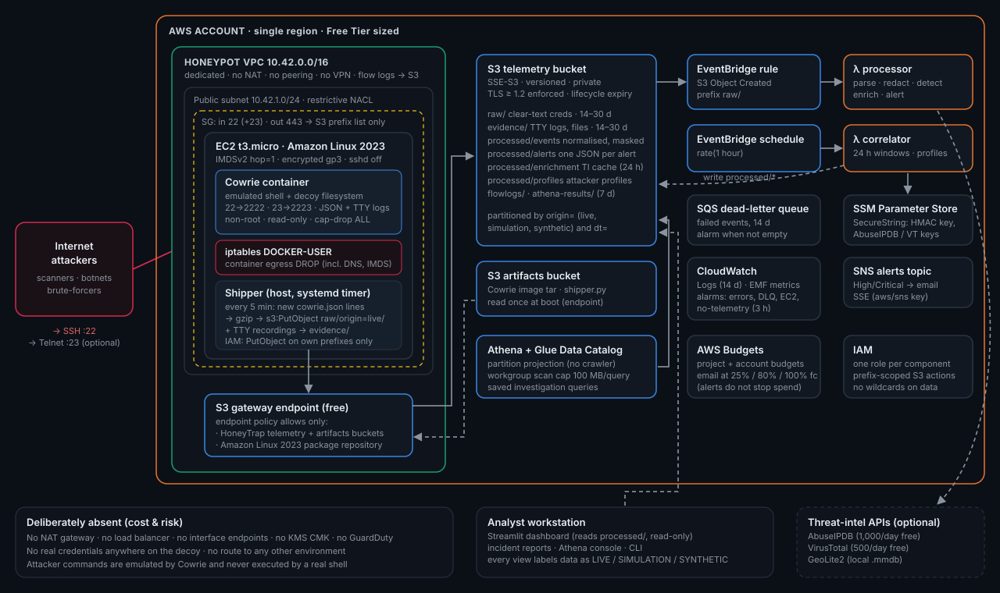
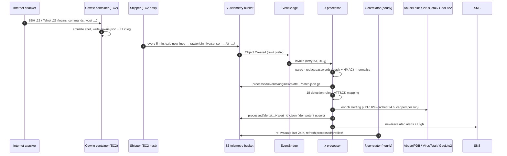

# Architecture

## Data flow

## Component responsibilities

| Component | Code | Responsibility |
|---|---|---|
| Decoy | `honeypot/cowrie/etc/`, `honeypot/configuration/build_fs.py`, `honeypot/Dockerfile` | Cowrie 3.1.4 with a "Northwind Freight" billing DB persona (fictional company), decoy files, and a userdb that accepts weak root passwords after a few failures |
| Shipper | `honeypot/shipper/shipper.py` | Incremental, at-least-once upload of complete JSON lines and TTY/evidence files; offsets committed only after upload |
| Parser / redaction | `backend/honeytrap/ingestion/` | Normalises Cowrie events. Passwords become a mask, a length and a keyed HMAC. Redirection writes are separated from downloads |
| Detection | `backend/honeytrap/detection/` | 18 rules, per-origin evaluation, deterministic alert IDs, severity escalation, attacker profiles |
| ATT&CK | `backend/honeytrap/mitre/` | Catalogue generated from MITRE's STIX bundle (v20); evidence required for every mapping |
| Enrichment | `backend/honeytrap/enrichment/` | Optional AbuseIPDB / VirusTotal / GeoLite2, TTL cache, rate limits, explicit `not_configured` / `skipped_non_public` states |
| Storage | `backend/honeytrap/storage/` | Same key layout on local disk and S3, so the CLI, Lambdas and dashboard share one data model |
| Lambdas | `lambda/handlers/` | Thin wrappers. Secrets from SSM SecureString, CloudWatch EMF metrics |
| Dashboard | `dashboard/` | Streamlit + Plotly: Overview, Attack Intelligence, Detection Center, MITRE, Investigation, Evidence Explorer, Architecture & Validation |
| IaC | `terraform/` | 6 modules (network, storage, honeypot, pipeline, analytics, monitoring), 2 environments |

## Why these choices

* **S3 + EventBridge + Lambda instead of CloudWatch Logs subscriptions or Kinesis.** Batching on the host keeps request counts low, and everything is free-tier or near-zero. S3 is also the evidence store and the Athena source.
* **Stateless rules over tumbling windows instead of DynamoDB state.** Simpler, free and idempotent. The hourly correlator compensates for batch boundaries (trade-offs: [docs/detections.md](../docs/detections.md)).
* **Container image delivered via S3 instead of pulling from Docker Hub.** The instance has *no* internet egress, not even during bootstrap. Packages come from the Amazon Linux 2023 repository, which is served from S3 and reachable through the gateway endpoint.
* **Lambdas outside a VPC.** A VPC Lambda would need NAT (≈ $32/month) or interface endpoints (≈ $7/month each) to reach S3, SNS, SSM and the TI APIs.
* **SSE-S3 instead of KMS CMKs.** Keeps the bill at zero. The trade-off (no key-level access separation) is documented in the Checkov skips.

## Data-origin labelling (end to end)

| Layer | How the origin is carried |
|---|---|
| S3 keys | `raw/origin=<o>/…`, `processed/events/origin=<o>/…`, `processed/alerts/origin=<o>/…` |
| Athena | `origin` partition (projection enum `live,simulation,synthetic`) |
| Events / alerts | `data_origin` field. Rules never mix origins |
| SNS | Subject `[HoneyTrap][<ORIGIN>][<Severity>]`, plus a "NOT real external activity" line for non-live alerts |
| Dashboard | Origin filter, an origin banner on every page, badges on alerts and attackers. Synthetic geo is labelled on the map |
| Reports | An origin statement at the top of every incident report |
